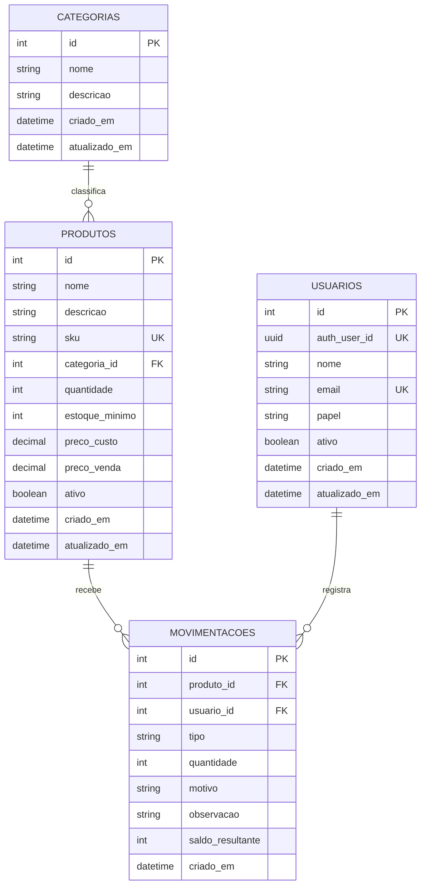

# EstoquePro — requisitos e modelos relacionais

## Enunciado interpretado

Desenvolver uma aplicação web para uma pequena loja controlar categorias, produtos e movimentações de estoque. O saldo disponível deve acompanhar cada entrada e saída, com histórico consultável. O sistema deve rejeitar quantidades inválidas e impedir que uma saída deixe o estoque negativo.

## Requisitos funcionais

- Cadastrar, consultar, editar e arquivar categorias e produtos.
- Filtrar produtos pelo nome, SKU, categoria e situação.
- Registrar entradas e saídas com quantidade, motivo, observação, usuário e data.
- Atualizar o saldo do produto na mesma transação que grava a movimentação.
- Listar produtos abaixo do estoque mínimo e sem estoque.
- Consultar histórico por produto, período e tipo.
- Gerar relatórios e exportações com filtros.
- Autenticar usuários pelo Supabase Auth e proteger a aplicação e a API.
- Aplicar permissões Admin/Operador no servidor; os papéis ficam no banco e não vêm de metadados controlados pelo usuário.

## Regras de negócio e integridade

1. Cada produto pertence a uma categoria existente (FK).
2. Uma categoria pode possuir vários produtos (1:N).
3. Cada movimentação pertence a um produto existente e a um usuário existente (duas FKs).
4. Um produto e um usuário podem possuir várias movimentações (1:N).
5. SKU e e-mail são únicos; categoria e SKU têm unicidade sem diferenciar maiúsculas/minúsculas.
6. Saldo, estoque mínimo, preços e quantidades não podem ser negativos; quantidade movimentada deve ser maior que zero.
7. O tipo aceita somente `ENTRADA` ou `SAIDA`; o papel aceita somente `ADMIN` ou `OPERADOR`.
8. A saída é rejeitada quando supera o saldo. Uma função e trigger PostgreSQL recalculam o saldo e gravam o saldo resultante junto da movimentação.
9. Perfis com movimentações não são excluídos, para manter a auditoria; podem ser desativados.
10. Um perfil criado pelo próprio cadastro começa com papel `OPERADOR`. A autorização sempre consulta o papel no banco.

## Modelo conceitual (DER)

## Modelo lógico

- **categorias**: `id` PK, `nome` único (case-insensitive), `descricao`, `criado_em`, `atualizado_em`.
- **produtos**: `id` PK, `nome`, `descricao`, `sku` único, `categoria_id` FK → `categorias.id`, `quantidade`, `estoque_minimo`, `preco_custo`, `preco_venda`, `ativo`, timestamps.
- **usuarios**: `id` PK, `auth_user_id` único → identidade do Supabase Auth, `nome`, `email` único, `senha_hash` legado/não usado para autenticar, `papel`, `ativo`, timestamps.
- **movimentacoes**: `id` PK, `produto_id` FK → `produtos.id`, `usuario_id` FK → `usuarios.id`, `tipo`, `quantidade`, `motivo`, `observacao`, `saldo_resultante`, `criado_em`.

## Modelo físico e carga de dados

- DDL PostgreSQL/Supabase: `supabase/migrations/20261127000100_initial_schema.sql` e `20261127000200_supabase_auth.sql`.
- Carga demonstrativa: `supabase/seed.sql`.
- Consultas de relatório: [`supabase/consultas.sql`](../supabase/consultas.sql).
- Primeiro administrador: `supabase/bootstrap_admin.sql` após cadastrar e confirmar a conta.
